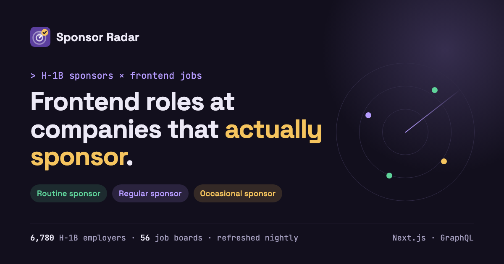
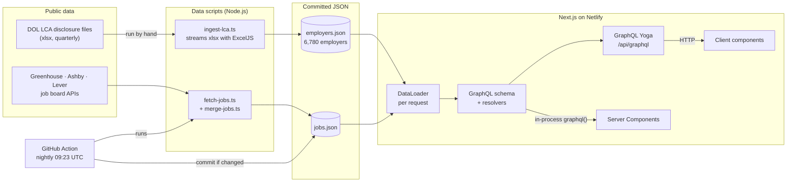

# Sponsor Radar

Which companies hiring frontend engineers actually sponsor H-1B visas?

**Live:** https://abhijeetpalanki-sponsor-radar.netlify.app · **API + GraphiQL:** [/api/graphql](https://abhijeetpalanki-sponsor-radar.netlify.app/api/graphql)



Sponsor Radar joins two public sources:

- **U.S. Department of Labor H-1B filings** (Labor Condition Application disclosure data). Every certified H-1B filing for a software occupation is reduced to a per-employer summary: filings, median wage, states.
- **Public job boards** (Greenhouse, Ashby, Lever). Open frontend and fullstack roles at 56 tracked companies, refreshed every night.

Each company gets a sponsorship tier from its filings: Routine (100 or more), Regular (25 to 99), Occasional (1 to 24) or None.

## Architecture



A few decisions worth knowing about:

- **The data is committed as JSON, not fetched per request.** Pages are statically generated and the API reads a file, so a visitor never waits on 56 job boards and a Lever outage can't break a page. A commit to `main` is what publishes new data, because Netlify deploys on push.
- **DataLoader is created per request.** A list of 50 jobs that asks for each company's sponsorship makes one batched lookup, not 50. `tests/api.test.ts` counts the batches to prove it.
- **The nightly refresh fails safe.** A board that errors keeps yesterday's roles. If more than a quarter of the boards fail, the script exits without writing, so the site keeps its current data. Output is sorted, so a reordered API response is not a change and does not trigger a deploy.
- **Server Components skip HTTP.** They run the same schema in-process through `graphql()`, while client components (search, filters, "show more") call `/api/graphql`.

## Try the API

```graphql
{
  jobs(filter: { remote: true, usOnly: true, minSoftwareFilings: 25 }, first: 5) {
    totalCount
    edges {
      node {
        title
        company { name sponsorshipTier sponsorship { softwareFilings medianWage } }
      }
    }
    pageInfo { hasNextPage endCursor }
  }
}
```

Pagination is cursor-based (`first` up to 100, `after`). Bad input such as an invalid cursor returns a typed `BAD_USER_INPUT` error.

## Stack

- Next.js 15 (App Router), React 19, TypeScript, Tailwind CSS v4
- GraphQL Yoga on Node.js, DataLoader
- Vitest
- GitHub Actions for the nightly refresh, Netlify for hosting

## Run locally

```bash
npm install
npm run dev            # http://localhost:3000, API + GraphiQL at /api/graphql
npm test
```

## Refresh the data

```bash
npm run data:jobs                                  # job boards (the GitHub Action runs this nightly)
npm run data:lca -- data/raw/LCA_Disclosure_*.xlsx # H-1B filings, quarterly (download from dol.gov)
```

DOL publishes the disclosure files quarterly at https://www.dol.gov/agencies/eta/foreign-labor/performance. The raw spreadsheets are large and are not committed; only the summary in `data/employers.json` is.

## Caveats

- An H-1B filing shows intent to employ, not a hire.
- Frontend work is usually filed under generic titles such as "Software Engineer", so total software filings is the more useful signal than frontend-titled filings.
- Company-to-employer matching uses the legal entity names in `src/server/companies.ts` and is checked by hand.
